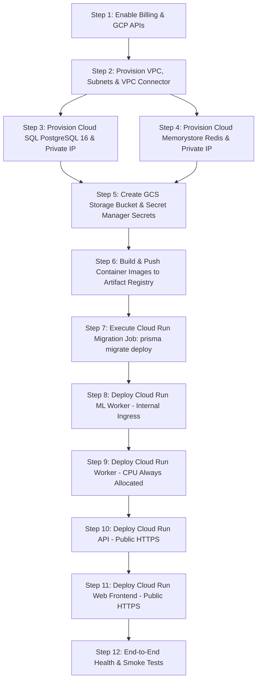

# CipherScope — Google Cloud Platform Production Pre-Flight Audit

**Document Date:** September 27, 2026  
**Target Environment:** Google Cloud Platform (GCP)  
**Project ID:** `gen-lang-client-0199571349`  
**Git Baseline:** `feature/ciperscope-hardening` at commit `f0c7cbe`  
**Status:** PRE-FLIGHT AUDIT ONLY — NO CLOUD RESOURCES PROVISIONED

---

## Executive Summary

This pre-flight specification defines the architecture, prerequisites, network topology, security posture, and deployment sequencing required to deploy CipherScope to Google Cloud Platform. 

Per release safety rules, **zero cloud resources have been created or modified** and **zero source code modifications are made**. This document establishes the exact configuration matrix and highlights blocking requirements (such as billing enablement and secret generation) that require user confirmation before Phase 9 infrastructure provisioning begins.

---

## 1. Required GCP Resources & Architecture

| Component | GCP Resource / Service | Specification / Tier | Purpose |
| :--- | :--- | :--- | :--- |
| **API** | Cloud Run (Service: `ciperscope-api`) | 1-2 vCPU, 2-4 GiB RAM, Min 1, Max 10 | Fastify REST API & SSE Server |
| **Worker** | Cloud Run (Service: `ciperscope-worker`) | 2 vCPU, 4 GiB RAM, Min 1, Max 5 (`--no-cpu-throttling`) | BullMQ background forensic workers |
| **ML Worker** | Cloud Run (Service: `ciperscope-ml-worker`) | 2 vCPU, 4 GiB RAM, Min 1, Max 3 (Internal ingress only) | FastAPI DistilBERT inference service |
| **Frontend** | Cloud Run (Service: `ciperscope-web`) | 1 vCPU, 512 MiB RAM, Min 1, Max 10 | Nginx static container serving Vite SPA |
| **Database** | Cloud SQL for PostgreSQL | PostgreSQL 16, `db-custom-2-7680` (2 vCPU, 7.5GB RAM), SSD 50GB | Persistent multi-tenant relational store |
| **Queue / Cache** | Memorystore for Redis | Redis 7.2, 1GB Basic/Standard tier, Private IP | BullMQ job queue & idempotency manager |
| **Object Storage** | Cloud Storage (GCS) | Standard Bucket (e.g. `ciperscope-raw-emails-production`) | Raw RFC 822 email files & evidence blobs |
| **Secrets** | Google Secret Manager | Encrypted secrets (`ciperscope-*`) | Zero plaintext secrets in container configs |
| **Container Registry**| Artifact Registry | Standard Docker repository (`ciperscope-repo`) | Immutable image storage |
| **VPC / Network** | VPC Network & Serverless VPC Connector | Subnet `/28` connector for Private IP connectivity | Cloud Run to Cloud SQL & Memorystore |
| **Observability** | Cloud Logging & Monitoring | Google Cloud Native | Aggregated logs, error alerts & health metrics |

---

## 2. Required GCP APIs

The following APIs must be enabled on project `gen-lang-client-0199571349`:

```bash
gcloud services enable \
  run.googleapis.com \
  sqladmin.googleapis.com \
  redis.googleapis.com \
  vpcaccess.googleapis.com \
  compute.googleapis.com \
  servicenetworking.googleapis.com \
  artifactregistry.googleapis.com \
  secretmanager.googleapis.com \
  cloudbuild.googleapis.com \
  storage.googleapis.com \
  cloudbilling.googleapis.com
```

*Note: `gmail.googleapis.com`, `pubsub.googleapis.com`, `logging.googleapis.com`, and `monitoring.googleapis.com` are already verified enabled on the project.*

---

## 3. IAM Permissions & Service Accounts

### Dedicated Service Accounts

1. **`ciperscope-api-sa`** (Cloud Run API Runtime):
   - `roles/cloudsql.client` (Connect to Cloud SQL via socket or Private IP)
   - `roles/secretmanager.secretAccessor` (Read API secrets at runtime)
   - `roles/storage.objectAdmin` (Read/write raw email objects in GCS)
   - `roles/pubsub.publisher` & `roles/pubsub.subscriber` (Gmail ingestion Pub/Sub)

2. **`ciperscope-worker-sa`** (Cloud Run Worker Runtime):
   - `roles/cloudsql.client`
   - `roles/secretmanager.secretAccessor`
   - `roles/storage.objectAdmin`
   - `roles/run.invoker` (Invoke private `ciperscope-ml-worker`)

3. **`ciperscope-ml-sa`** (Cloud Run ML Runtime):
   - `roles/secretmanager.secretAccessor`

---

## 4. Required Secret Manager Secrets

The following secrets must be created in Google Secret Manager prior to service launch:

| Secret Name | Source / Value Description | Target Consumer |
| :--- | :--- | :--- |
| `ciperscope-database-url` | Full PostgreSQL connection string with SSL | API, Worker, Migration Job |
| `ciperscope-redis-url` | `redis://<MEMORYSTORE_PRIVATE_IP>:6379` | API, Worker |
| `ciperscope-jwt-secret` | Cryptographically random 64-char hex string | API |
| `ciperscope-gmail-token-encryption-key` | Cryptographically random 32-byte (64-char) hex key | API, Worker |
| `ciperscope-ml-service-token` | Random shared Bearer token for inter-service auth | API, Worker, ML Worker |
| `ciperscope-google-client-id` | Production OAuth 2.0 Web Client ID (from Google Console) | API |
| `ciperscope-google-client-secret` | Production OAuth 2.0 Web Client Secret | API |
| `ciperscope-maxmind-license-key`| MaxMind GeoIP2 Web Service license key (optional) | Worker |
| `ciperscope-abuseipdb-api-key` | AbuseIPDB API key for IP scoring (optional) | Worker |
| `ciperscope-virustotal-api-key`| VirusTotal API key for attachment scoring (optional) | Worker |

*No private keys, passwords, or tokens will ever be checked into Git.*

---

## 5. Required Environment Variables

### `ciperscope-api`
```env
NODE_ENV=production
PORT=3000
CORS_ORIGIN=https://<FRONTEND_DOMAIN>
DATABASE_URL=secretref:ciperscope-database-url
REDIS_URL=secretref:ciperscope-redis-url
JWT_SECRET=secretref:ciperscope-jwt-secret
JWT_ISSUER=ciperscope-auth
JWT_AUDIENCE=ciperscope-web
GMAIL_TOKEN_ENCRYPTION_KEY=secretref:ciperscope-gmail-token-encryption-key
GOOGLE_CLIENT_ID=secretref:ciperscope-google-client-id
GOOGLE_CLIENT_SECRET=secretref:ciperscope-google-client-secret
GOOGLE_OAUTH_REDIRECT_URI=https://<API_DOMAIN>/api/v1/integrations/gmail/callback
GOOGLE_PUBSUB_TOPIC=projects/gen-lang-client-0199571349/topics/ciperscope-gmail-watch
RAW_EMAIL_STORAGE_PATH=/app/data/emails
BLOCKCHAIN_ENABLED=false
```

### `ciperscope-worker`
```env
NODE_ENV=production
WORKER_PORT=3001
DATABASE_URL=secretref:ciperscope-database-url
REDIS_URL=secretref:ciperscope-redis-url
GMAIL_TOKEN_ENCRYPTION_KEY=secretref:ciperscope-gmail-token-encryption-key
RAW_EMAIL_STORAGE_PATH=/app/data/emails
ML_SERVICE_URL=http://ciperscope-ml-worker:8000
ML_SERVICE_TOKEN=secretref:ciperscope-ml-service-token
RDAP_ENABLED=true
BLOCKCHAIN_ENABLED=false
```

### `ciperscope-ml-worker`
```env
PORT=8000
ML_SERVICE_TOKEN=secretref:ciperscope-ml-service-token
HF_HOME=/home/mluser/.cache/huggingface
```

### `ciperscope-web`
```env
VITE_API_URL=https://<API_DOMAIN>
```

---

## 6. Network Topology & Cross-Service Connectivity

```
[ Public Internet / Clients ]
       │
       ├── HTTPS (Port 443) ──> [ Cloud Run: ciperscope-web ]
       │
       └── HTTPS (Port 443) ──> [ Cloud Run: ciperscope-api ]
                                        │
                         [ Direct VPC Egress / Serverless VPC Connector ]
                                        │
           ┌────────────────────────────┼────────────────────────────┐
           ▼                            ▼                            ▼
[ Cloud SQL PostgreSQL ]     [ Memorystore Redis ]     [ Cloud Run: ciperscope-worker ]
(Private IP: 10.x.x.x)       (Private IP: 10.x.x.x)    (CPU always allocated)
                                                                     │
                                                                     ▼ (VPC Internal)
                                                       [ Cloud Run: ciperscope-ml-worker ]
                                                       (Ingress: Internal Only)
```

1. **Cloud Run to Cloud SQL**: Connected securely over Private IP through VPC egress or the Cloud SQL Unix socket connector.
2. **Cloud Run to Memorystore**: Memorystore has no public IP; Cloud Run communicates with Redis strictly through the Serverless VPC Access connector.
3. **API to ML Worker**: Routed internally through VPC or Cloud Run authenticated internal service invocation.

---

## 7. Storage & Raw Email Synchronization

- CipherScope stores raw RFC 822 email payloads on disk via `RAW_EMAIL_STORAGE_PATH=/app/data/emails`.
- In Cloud Run, both the `ciperscope-api` and `ciperscope-worker` services mount a shared Google Cloud Storage (GCS) bucket (`gs://ciperscope-raw-emails-production`) as a Cloud Storage FUSE Volume Mount at `/app/data/emails`.
- **Result**: Zero source code changes required. Uploads written by the API are immediately accessible to the Worker.

---

## 8. Prisma Production Migration Procedure

1. Before starting or updating any API/Worker containers, a one-off **Cloud Run Job** (`ciperscope-db-migrate`) executes:
   ```bash
   pnpm --filter @ciperscope/database exec prisma migrate deploy
   ```
2. **Safety rules**:
   - `prisma migrate reset` is strictly disallowed.
   - `prisma db push` is strictly disallowed.
   - Migrations are applied in forward-only, transactional order against Cloud SQL.

---

## 9. Deployment Order & Phased Execution



---

## 10. Risks & Mitigation

| Identified Risk | Severity | Mitigation Strategy |
| :--- | :--- | :--- |
| **Worker Throttling** | High | Configure Cloud Run with `--no-cpu-throttling` and `min-instances=1` so BullMQ queue polling never sleeps. |
| **Private IP Isolation** | High | Use VPC connector for both Cloud SQL and Memorystore; no public IP exposure. |
| **Cold Starts for ML Model** | Medium | Configure `min-instances=1` on `ciperscope-ml-worker` and pre-cache DistilBERT weights in the container image. |
| **Database Migration Locking** | Medium | Run migrations via an isolated Cloud Run Job before routing traffic to new revisions. |
| **Secret Exposure** | Critical | Use Secret Manager volume mounts / env references; never pass secrets in CLI flags or environment blocks directly. |

---

## 11. Rollback Procedure

1. **Cloud Run Services**: Instant rollback using Cloud Run revision traffic splitting:
   ```bash
   gcloud run services update-traffic <SERVICE_NAME> --to-revisions=<PREVIOUS_REVISION>=100 --region=<REGION>
   ```
2. **Database**: Automated Cloud SQL point-in-time recovery (PITR) and daily automated snapshots enabled.
3. **Application**: Release commit `f0c7cbe` is tagged and preserved.

---

## 12. Estimated Resource Requirements & Sizing

| Component | Minimum Production Sizing | Monthly Cost Estimate (GCP On-Demand) |
| :--- | :--- | :--- |
| Cloud SQL (db-custom-2-7680) | 2 vCPU, 7.5GB RAM, 50GB SSD | ~$100 - $140 |
| Memorystore Redis (Basic 1GB) | 1 GB memory | ~$35 - $45 |
| Serverless VPC Connector | e2-micro / f1-micro (2 instances) | ~$15 - $20 |
| Cloud Run (API, Worker, ML, Web)| Autoscaled (with min-instances=1) | ~$40 - $80 |
| Cloud Storage & Secret Manager | < 50GB data | ~$5 |
| **Total Estimated Baseline** | | **~$195 - $285 / month** |

---

## 13. Items Requiring User Confirmation (Action Required)

Before proceeding to Phase 9 provisioning, confirm the following:

1. **GCP Project & Billing**:
   - The current project is `gen-lang-client-0199571349`.
   - **Status**: Cloud Billing API is currently disabled / not linked. Confirm if you will link a billing account to `gen-lang-client-0199571349` or specify another GCP project with active billing.
2. **Target GCP Region**:
   - Recommended: `us-central1` (Iowa) or `us-east1` (South Carolina). Confirm preferred region.
3. **Domain & Routing Names**:
   - Are you planning to map custom domains (e.g. `cipherscope.io` and `api.cipherscope.io`), or should we begin with standard Google Cloud Run HTTPS service URLs (`https://ciperscope-*-xxxx.a.run.app`)?
4. **Web Frontend Container Strategy**:
   - `apps/web` requires an Nginx container specification to serve the production Vite build on Cloud Run. Confirm approval to add `apps/web/Dockerfile` and `apps/web/nginx.conf` during infrastructure preparation.
5. **Blockchain Anchoring Mode**:
   - Confirmed continuing with safe `NullBlockchainProvider` fallback (zero gas fees, zero external wallet required).
